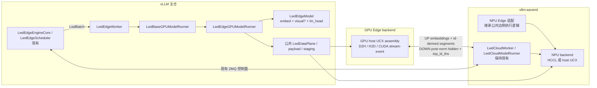

# LWD 边侧逻辑上移 vLLM：GPU Edge + NPU Cloud 设计

> 状态：代码与普通 Python UT 已完成；待 GPU/NPU 真机 UCX/HCCL 与 rank-replay 验收
> 当前代码基线：vllm / vllm-ascend 均为 `support_gpu` 分支
> 目标：将 LWD 边侧逻辑上移到 vLLM，新增 GPU Edge → NPU Cloud（UCX），同时保留 NPU Edge → NPU Cloud（HCCL 或 UCX）
> RFC：实施前创建并关联；本设计涉及的架构改动超过 500 LOC，按仓内规范执行

## 1. 硬性约束与设计结论

本设计以以下约束为前提，不再讨论与其冲突的替代方案：

1. **DOWN 必须沿用 rank-replay。** 云侧发送 post-norm hidden states 和 `top_id_ths`，边侧通过本地 `lm_head` 计算 logits 并按名次恢复 token。生产路径不得改为传输 token ID，也不得以跨设备数值风险为由绕过回放。
2. **runner 沿用 vLLM 原生继承体系。** 不引入 `LwdEdgeRuntime`。过渡期的公共基类命名为 `LwdBaseGPUModelRunner`，边侧实现为 `LwdEdgeGPUModelRunner`；后续云侧 GPU 也完成上移后，再将公共基类改名为 `LwdBaseModelRunner`。
3. **边侧不做“0 decoder layer”兼容。** 不实例化完整 `ForCausalLM` / `ForConditionalGeneration`，不调用 `make_layers`，不保留 decoder 或 `PPMissingLayer` 占位，不为零层模型修补 MoE 元数据和 decoder finalize。边侧模型从构建开始就只有其实际需要的模块。
4. **两种部署必须共存：**
   - GPU Edge → NPU Cloud：使用 host UCX；
   - NPU Edge → NPU Cloud：保留现有 device HCCL 和 host UCX 两条路径。
5. **云侧主体暂不上移。** `LwdCloudWorker`、`LwdCloudModelRunner`、云 Engine/Scheduler、early-recv、host staging 和 MTP 保持现有归属，只切换到上移后的公共代码。
6. **协议保持兼容。** 不新增 DOWN token-id 模式，不改变 `LwdC2eNotify` 的生产字段语义，不改变 UHC1 线协议和 rank-replay 的 seqno 规则。

## 2. 当前代码盘点

### 2.1 已位于 vLLM 的部分

- LWD 配置和拓扑：`vllm/config/lwd/`
- 控制面：`vllm/v1/lwd_control/lwd_comm/`
- 边云 Engine/Scheduler：`vllm/v1/lwd_control/`
- LWD batch：`vllm/v1/core/sched/output.py`
- host UCX 纯主机传输：`vllm/v1/lwd_comm/data_comm/`
- 角色模块与权重裁剪：`vllm/model_executor/models/utils.py`、`vllm/model_executor/model_loader/lwd_weight_filter.py`
- Engram 边侧哈希：`vllm/v1/lwd_control/lwd_model/deepseek_v41/lwd_engram_hasher.py`
- EngineCore 按角色分流：`vllm/v1/engine/core.py`

这些部分原则上不重复迁移，只做必要的接入调整。

### 2.2 迁移前位于 vllm-ascend 的边侧核心

- `vllm_ascend/worker/lwd_edge_model/lwd_edge_worker.py`
- `vllm_ascend/worker/lwd_edge_model/lwd_edge_model_runner.py`
- `vllm_ascend/worker/lwd_edge_model/lwd_edge_mm_cache.py`
- `vllm_ascend/worker/lwd_base_model/lwd_pinned_staging.py`
- `vllm_ascend/worker/lwd_hash/lwd_up_payload.py`
- `vllm_ascend/worker/lwd_hash/lwd_hash_tables.py`
- `vllm_ascend/distributed/lwd_data_plane/` 中的公共类型、future、FIFO、host queue 和加扰逻辑

当前 Ascend 在 `vllm_ascend/platform.py` 按角色选择 `LwdEdgeWorker` / `LwdCloudWorker`；CUDA 平台尚没有对应的 LWD 边侧分派。上述模块已按本设计迁入 vLLM 公共层，Ascend 仅保留 NPU 后端、runner 适配与云侧主体。

### 2.3 可复用的继承事实

`vllm_ascend.worker.model_runner_v1.NPUModelRunner` 本身继承 `GPUModelRunner`。因此，`LwdBaseGPUModelRunner` 可以放在原生 runner 继承链中承载边侧公共执行逻辑，Ascend 边侧只覆写 NPU 初始化与设备钩子，不需要另建一套 `Runtime` 或复制边侧业务流程。

## 3. 目标与非目标

### 3.1 目标

- GPU 边侧只依赖 vLLM，不 import `vllm_ascend` 或 `torch_npu`。
- 上移边侧 worker/model runner、边侧模型构建、UP payload、MM cache 和必要的数据面公共代码。
- GPU Edge → NPU Cloud 通过 UCX 完成 UP/DOWN 张量传输及 rank-replay。
- NPU Edge → NPU Cloud 的 HCCL 和 UCX 均保持可用。
- 公共代码只有一份，NPU 云侧直接调用 vLLM 中的实现。
- 非 LWD 的普通 CUDA、普通 Ascend，以及既有 NPU→NPU LWD 行为均不受影响。

### 3.2 非目标

- 不上移云侧 Engine/Scheduler/Worker/ModelRunner 主体。
- 不支持 GPU Edge 使用 `data_plane_comm=device`，不实现 NCCL 与 HCCL 互通。
- 不上移 GPU Cloud；仅为后续云侧 GPU 上移保留 `LwdBaseGPUModelRunner` 的命名和继承位置。
- 不引入 DOWN token-id 生产模式，不修改协议来规避 rank-replay。
- 不保留完整模型加“0 层”补丁，不恢复两段 PP 表达边云关系。
- 不新增动态 peer-restart 恢复能力；现有失败时整组重启的语义不变。

## 4. 总体架构



依赖方向：

```text
vllm 公共边侧逻辑与协议
        ├── GPU 设备适配（vllm）
        └── NPU 设备适配（vllm-ascend）

vllm 不依赖 vllm-ascend；vllm-ascend 调用 vLLM 公共实现。
```

## 5. Runner 继承与职责划分

### 5.1 过渡期命名

```text
GPUModelRunner
└── LwdBaseGPUModelRunner
    └── LwdEdgeGPUModelRunner
```

Ascend 的 NPU 边侧复用 `LwdEdgeGPUModelRunner` 中的公共执行逻辑，只保留 NPU 初始化、stream/event 和设备内存操作等差异。`NPUModelRunner` 已继承 `GPUModelRunner`，不另起一套边侧业务流程。

后续 GPU 云侧也上移后，演进为：

```text
LwdBaseModelRunner
├── LwdEdgeModelRunner
└── LwdCloudModelRunner
```

改名属于后续完整上移工作，本阶段不提前使用 `LwdBaseModelRunner` 覆盖 Ascend 已有的同名类。

### 5.2 `LwdBaseGPUModelRunner`

只承载公共 runner 基础设施：

- 持有 worker 引用及其 `comm_service`；
- 持有 `vllm_config`、`model_config`、device；
- 提供 `LwdPinnedStaging` 的命名懒创建；
- 不包含云侧调度、early-recv、host staging 或 MTP 逻辑。

### 5.3 `LwdEdgeGPUModelRunner`

承载现有 NPU 边侧 runner 的公共业务：

- `load_model` 后的边侧初始化和 UP layout 构建；
- EMBED：注册请求状态、H2D token ids、文本 embedding、Hash MoE 查表、Engram 哈希、UP pack/send；Qwen3.5 通过原生视觉塔与多模态合并路径处理图像输入，其他未登记模型 fail-fast；
- UNEMBED：提交 DOWN receive、等待设备事件、`compute_logits`、稳定排序、按 `top_id_ths` 恢复 token；
- 每连接 UP send future 队列和连续成功 watermark；
- `finished_req_ids` 对应的 MM feature 与 Engram prompt 清理；
- 不进入原生 `_prepare_inputs`、完整模型 forward、sampler、KV cache 或 CUDA Graph 路径。

### 5.4 `LwdEdgeWorker`

- 复用原生 `Worker` 的 CUDA 初始化。
- 在初始化后创建 `LwdEdgeGPUModelRunner`，初始化 host 数据面。
- `execute_model` 只按 `LwdBatchType` 分派 EMBED、UNEMBED 和空批 watermark。
- `get_kv_cache_spec()` 返回 `{}`，不进入 KV cache 显存评估与分配。
- `compile_or_warm_up_model()` 跳过完整模型 warmup 和 graph capture。
- shutdown 先关闭数据面，再执行原生 worker teardown。
- CUDA 平台只在 `lwd_config.role == "edge"` 时选择它；普通 CUDA 和非 LWD 路径不变。

## 6. 边侧模型：按职责构建，不做“0 层”适配

### 6.1 构建原则

边侧不再通过原生完整模型类构建后裁剪，而是使用独立的 `LwdEdgeModel` 构建入口。每个受支持模型族提供 edge builder，并复用原生模型中已经存在的子模块构造函数、量化配置和权重映射。

边侧模型只包含：

| 模块 | 是否保留 | 用途 |
| --- | --- | --- |
| `embed_tokens` | 保留 | prompt embedding；云侧 decode 也持有本方 embedding |
| `lm_head` + `LogitsProcessor` | 保留 | DOWN rank-replay 计算 logits |
| `visual` / 模型族实际视觉子模块 | 按需保留 | 多模态编码与 embedding 合并 |
| decoder layers / `PPMissingLayer` | **不创建** | 全部在云侧 |
| final norm | **不创建** | 云侧 DOWN 前已完成 norm |
| `hc_head_*` | **不创建** | 仅云侧 trunk forward 使用 |
| MTP / draft | **不创建** | 云侧持有 |
| attention top-k buffer、辅助 stream、Engram 层与表 | **不创建** | 与边侧 embed/unembed 无关；边侧只计算 CPU Engram hash |
| KV cache / Mamba state | **不创建** | 边侧无 attention/state forward |

因此，不再需要修补完整模型中的 `get_expert_mapping`、`set_moe_parameters`、`finalize_mega_moe_weights` 等“0 层”路径，因为边侧根本不会调用它们。

### 6.2 模型构建与加载

实际组件：

```text
LwdEdgeModel（nn.Module）
├── 模型族 edge builder
├── 复用原生 embed / visual / lm_head 子模块
├── embed_input_ids(...)
├── embed_multimodal(...)（多模态模型）
├── compute_logits(...)
└── load_weights(...)
```

- 按 `model_config.architecture` 选择 edge builder；未登记的模型族 fail-fast。当前登记 DeepSeek V4/V4.1 文本路径和 Qwen3.5 多模态路径。
- 复用原生 `VocabParallelEmbedding`、`ParallelLMHead`、量化配置和 `hf_to_vllm_mapper`，不实例化完整模型；`lm_head` 保持原生未量化构建方式。
- 模块命名保持与原生权重映射兼容，`AutoWeightsLoader`、现有 `hf_to_vllm_mapper` 和量化配置继续工作。
- 使用 `LwdEdgeModelLoader(BaseModelLoader)`：仅将 `create_model` 替换为 edge builder；`download_model`、`load_weights` 和 post-load 处理委托给现有 loader，保留 Default/Dummy 等加载路径及量化后处理。
- `LwdEdgeModel.load_weights` 只遍历边侧模块，不进入完整模型的 decoder/MoE 权重流程。
- `tid2eid` 仍由独立的 safetensors 读取器加载到 CPU，不要求构建 MoE 层。

### 6.3 对现有角色裁剪规则的影响

- 新边侧不再调用 `make_layers`；GPU/NPU 边侧均使用同一 edge builder，原有的 LWD 零层分支已删除，不保留“0 层 + 占位”的历史实现。
- `hc_head_{fn,base,scale}` 从“边云双保留”修正为 **cloud-only**，边侧模型和 edge checkpoint 都不再需要它。
- 角色归属表、加载过滤器和 `split_lwd_checkpoint.py` 必须同步修改，确保“实际构建的模块、加载的权重、离线切片”一致。
- 实施时同步更新 `lwd_role_module_skip.md`、`lwd_weight_split.md` 中已经被本设计替代的描述，避免新旧语义并存。

## 7. UP/DOWN 与 rank-replay 契约

### 7.1 UP：GPU embed → NPU cloud

```text
SchedulerOutput.lwd_batch（EMBED）
  → 按 req_ids 顺序展开本 chunk 的 token ids
  → GPU H2D
  → 必要时视觉编码、跨请求 cache、chunk 窗口切片和 embedding 合并
  → model.embed_input_ids
  → 可选 tid2eid 查表和 Engram prompt hash
  → LwdUpPayloadLayout.pack
  → UP seqno 对应的 UCX send
  → 连续成功 send prefix 形成 per-connection watermark
```

原始 prompt token ids 只用于边侧本地 embedding、查表和哈希，不作为通用 token-id 字段传输。UP 中模型必需的 id-derived 段仍按现有协议传输：

```text
[embeddings | Hash MoE expert-id bytes? | Engram bucket-index bytes?]
```

`LwdUpPayloadLayout` 上移后由 GPU 边侧和 NPU 云侧共同调用，pack/unpack、tail sizes、host buffer sizing 和帧长校验共用同一事实源。

### 7.2 DOWN：NPU cloud → GPU rank-replay

```text
云侧完成 transformer + final norm + sampling/top-k
  → DOWN 发送 post-norm hidden states
  → 控制面发送同 seqno 的 top_id_ths、accepted counts 和 finish metadata
  → GPU 边侧接收 hidden 并按 hidden_size reshape
  → 边侧本地 lm_head + LogitsProcessor 得到 logits
  → 对每行执行稳定降序排序（同值按 token ID 升序）
  → sorted_idx[i, top_id_ths[i]] 恢复 token
  → 按 num_accept_tokens 切回各请求并交给 LwdEdgeScheduler
```

硬性要求：

- `LwdC2eNotify.token_ids` 只保留现有诊断用途，不进入本设计的生产路径。
- 不增加 `down_delivery` 等配置，不增加 token-id 旁路。
- GPU 与 NPU 的 rank-replay 一致性是发布门槛：若出现名次或近并列 logits 不一致，必须修正权重、dtype、量化布局或 kernel 语义，不能改用 token-id 规避。
- hidden 必须仍是 post-norm；边侧 `compute_logits` 不得再次执行 norm。
- stable sort、请求行顺序、accepted-count 对齐和 seqno 配对必须与云侧保持一致。

## 8. 数据面公共化与设备适配

### 8.1 公共部分上移到 vLLM

- `LwdChannelType`、`LwdTransferRequest`、`LwdTransferResult`
- `LwdTransferFuture` 的状态、deferred bind、staged completion 和错误传播
- `LwdDataPlane` 的 submit、skip、abort、reap、shutdown
- 每 `(connection, channel, op)` 的 seqno FIFO、out-of-order hold、重复/跳过 seqno 处理
- send snapshot 和 keepalive
- host UCX link bootstrap、listener、token、QoS、block policy
- `LwdPinnedStaging`
- `LwdUpPayloadLayout`
- `LwdPayloadScrambler`（int16 view XOR，算法本身不依赖 NPU）

### 8.2 设备差异保留在 backend

公共 `LwdBaseTransferQueue` / host queue 只负责协议和顺序，具体执行由 backend 提供：

- device 和 receive buffer 分配；
- current stream、stream wait、event record/query；
- D2H/H2D 和 staged copy；
- receive tensor 的 stream 生命周期；
- 工作线程的 device 绑定。

GPU backend 使用 CUDA stream/event，并在 UCX sender/receive callback 线程中显式绑定 CUDA device。NPU backend 沿用现有 NPU 操作。

### 8.3 支持矩阵

| Edge → Cloud | `data_plane_comm=device` | `data_plane_comm=host` |
| --- | --- | --- |
| GPU → NPU | 不支持，启动期拒绝 | **本设计支持，UCX** |
| NPU → NPU | **保留，HCCL** | **保留，UCX** |

NPU HCCL 的 group/channel 创建留在 vllm-ascend；公共 FIFO 只抽取与设备无关的排序、skip、abort 和完成语义。

## 9. 模块迁移清单

| 现有模块 | 目标归属与处理 |
| --- | --- |
| `lwd_edge_worker.py` | 上移分派逻辑，新增 vLLM `LwdEdgeWorker`；Ascend 只保留设备适配 |
| `lwd_edge_model_runner.py` | 上移为 `LwdBaseGPUModelRunner` + `LwdEdgeGPUModelRunner`，不设置 `Runtime` |
| `lwd_edge_mm_cache.py` | 原逻辑上移，GPU/NPU 共用 |
| `lwd_pinned_staging.py` | 上移 vLLM，云侧 runner 改为 import 公共实现 |
| `lwd_up_payload.py` | 上移 vLLM，云侧 worker/runner 改为 import 公共实现 |
| `lwd_hash_tables.py` | 上移到边侧模型辅助模块 |
| `lwd_engram_hasher.py` | 已在 vLLM，直接复用 |
| `lwd_payload_scrambler.py` | 上移公共实现，GPU/NPU 共用并做 known-answer 校验 |
| transfer types / future / FIFO / data plane | 公共部分上移，HCCL 与设备执行分别留在对应 backend |
| host UCX / block policy | 公共部分上移，设备复制和 stream/event 由 backend 实现 |
| `LwdCloudWorker` / `LwdCloudModelRunner` | 留在 vllm-ascend，仅切换到公共 import |
| cloud early-recv / host staging / MTP | 留在 vllm-ascend，本期不上移 |
| NPU HCCL groups / channels | 留在 vllm-ascend，保持 NPU→NPU device 模式 |

## 10. 云侧需要的改动

云侧不做功能迁移，只做以下适配：

1. 将 UP payload、staging、transfer types/future/FIFO、scrambler 等 import 切换到 vLLM 公共实现。
2. NPU host queue 和 NPU edge 改为复用公共基类与公共执行逻辑，覆写设备钩子。
3. 保留现有 `LwdCloudWorker` / `LwdCloudModelRunner` 的调度、UP early-recv、host staging、DOWN collect/send 和 MTP 行为。
4. 不新增 DOWN token-id 生产逻辑，不修改 `LwdC2eNotify` 的 rank-replay 语义。
5. 用现有 NPU→NPU HCCL 和 UCX 回归证明公共抽取没有改变行为。

## 11. 启动校验与失败语义

以下情况必须在启动期 fail-fast：

- GPU edge 配置了 `data_plane_comm=device`；
- GPU edge 的 TP、PP 或 DP 大于 1；
- `use_v2_model_runner=True`（本期只支持 V1，与当前 LWD cloud V1 约束一致）；
- 模型族没有 edge builder，或缺少必需的 `embed_input_ids` / `compute_logits` 契约；
- UP dtype 不符合 `LwdUpPayloadLayout` 当前 BF16 要求；
- 边云 UP layout、block size、UHC1 token 或 QoS 不一致；
- GPU host sidecar 尚未完成独立验证却配置了 `sidecar`；首阶段先支持 `in_process`；
- 加载后仍存在未覆盖的边侧参数，或 checkpoint 中混入未分类张量。

运行期保持现有语义：

- send/recv 错误不得推进成功 watermark；
- aborted seqno 不阻塞后续 FIFO；
- 链路失败不向后续请求隐藏异常，不做静默重放；
- 不提供 peer-restart 自动恢复，按现有整组重启模型处理。

## 12. 实施拆分

### PR1：公共协议与数据面提取

- 上移 payload、staging、scrambler、transfer types/future/FIFO 和公共 data plane。
- Ascend 切换 import 和继承关系。
- 先跑通 NPU→NPU HCCL 与 UCX，证明行为不变。

### PR2：GPU host UCX backend

- 抽取公共 host queue/UCX 装配。
- 实现 GPU stream/event、buffer、D2H/H2D 和线程 device 绑定。
- 完成小帧、大帧、乱序、abort、断链、watermark 和加扰验证。

### PR3：边侧 runner 与 worker 上移

- 新增 `LwdBaseGPUModelRunner`、`LwdEdgeGPUModelRunner`、`LwdEdgeWorker`。
- 接入 CUDA worker 选择、空 KV、空批 watermark 和 shutdown。
- Ascend 边侧复用公共执行逻辑，删除重复业务实现。

### PR4：独立边侧模型构建

- 引入 `LwdEdgeModel`、edge builder 和 `LwdEdgeModelLoader`。
- 接入目标模型族的 embed/visual/lm_head 子模块和权重映射。
- 删除新路径对完整模型及 `make_layers` LWD 分支的依赖。
- 将 `hc_head` 修正为 cloud-only，并同步角色归属、加载过滤、离线切分和相关旧文档。

### PR5：GPU Edge → NPU Cloud rank-replay 联调

- 打通 UP embeddings、可选 Hash/Engram 段、DOWN hidden 和 top-k 回放。
- 验证文本、长 chunk、并发、abort、prefix/refill、结构化输出和已支持的多模态/MTP。
- 按模型逐个开放支持，不以通用 runner 存在为由宣称所有模型可用。

## 13. 测试与验收

### 13.1 单元测试

- 依赖方向：GPU 边侧模块无 `vllm_ascend`、`torch_npu` import；普通 CUDA/Ascend 路径不变。
- `LwdEdgeModel` 的模块清单中没有 decoder、`PPMissingLayer`、norm、`hc_head`、MTP 和 KV 相关模块。
- edge builder 与原生子模块的 embed/visual/lm_head 初始化和权重映射一致。
- payload 全段/可选段 roundtrip，覆盖大于 255 的 expert ID、Engram hash、空段和错误帧长。
- seqno 乱序、跳过、重复、abort、shutdown 和连续 watermark。
- pinned staging 轮转、扩容和事件同步。
- MM 跨 chunk、同图共享、refill、finish/abort 清理。
- stable sort 的同值顺序、请求行顺序、accepted-count 对齐。
- host/device 配置、TP/PP/DP、V2、dtype、不支持的模型和 sidecar 均 fail-fast。
- `LwdEdgeModelLoader` 保留 Default/Dummy loader 和量化后处理行为。
- Ascend 现有 LWD 单测全部继续执行。

### 13.2 真机验证

- GPU Edge → NPU Cloud（UCX）：UP/DOWN 字节、加扰、帧长和 seqno 正确。
- NPU Edge → NPU Cloud 分别跑 HCCL 和 UCX 回归。
- rank-replay 必须逐 token 对比云侧采样结果与边侧回放结果；覆盖普通、长序列、MTP、并发以及近并列 logits 场景，出现不一致即阻断发布。
- 文本、长 prompt chunk、并发、abort、prefix/refill、结构化输出、多模态和 MTP 按模型支持矩阵验收。
- 记录 TTFT、TPOT、吞吐、GPU/NPU 利用率、host pinned memory 和 UP/DOWN 分段耗时，确认无周期性停顿和请求级资源泄漏。
- sidecar 未单独通过 GPU 真机验证前不开放。

## 14. 备选方案

| 方案 | 说明 | 结论 |
| --- | --- | --- |
| 复制一套 GPU edge 和 CUDA 数据面 | 快速，但 payload、FIFO、abort、watermark 会形成两套实现 | 不采用 |
| **公共 runner/模型/数据面上移，设备差异下沉 backend** | 一份业务逻辑，GPU→NPU 与 NPU→NPU 共存，云侧直接复用公共代码 | **采用** |
| 边云主体一次性全部上移 | 统一最终结构，但本期会牵动 cloud early-recv、host staging、MTP | 超出本期范围 |

## 15. 本期范围基线

- 仅支持 GPU Model Runner V1、host `in_process`、边侧单卡、BF16 UP payload；当前开放 DeepSeek V4/V4.1 文本路径与 Qwen3.5 多模态路径。
- GPU edge 必须使用 host UCX；NPU edge 继续支持 HCCL 和 UCX。
- 云侧只复用公共代码，不迁移云侧主体。
- 模型按 edge builder 和真机 rank-replay 验收逐个开放。
- 本设计不引入任何 DOWN token-id 生产路径，也不保留完整模型的“0 decoder layer”兼容层。
