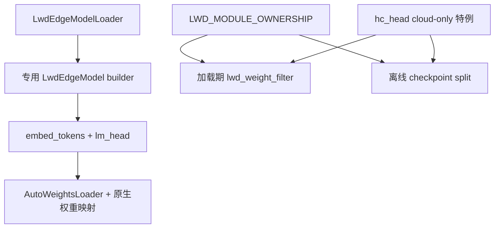

# LWD 角色模块归属与边侧模型构建

> 当前实现以 [lwd_gpu_edge_upstream.md](lwd_gpu_edge_upstream.md) 为准。本文保留归属表的设计背景，并记录独立边侧模型方案对早期“完整模型裁剪”方案的替代。

## 1. 当前结论

LWD 使用 rank-replay：云侧发送 post-norm hidden states 和 `top_id_ths`，边侧以本地 `lm_head` 计算 logits 并按名次恢复 token。生产 DOWN 路径不传输 token ID。

边侧不再通过完整 `ForCausalLM` / `ForConditionalGeneration` 加角色裁剪来构造模型，也不使用“0 decoder layer”适配：

- 不调用 `make_layers`，不创建 decoder、`PPMissingLayer`、final norm、`hc_head`、MTP、KV cache 或 MoE 占位；
- `LwdEdgeModelLoader` 按架构选择专用 builder；未登记的架构在加载前 fail-fast；
- 当前 builder 覆盖 DeepSeek V4/V4.1 文本路径和 Qwen3.5 多模态路径；前者只创建 `embed_tokens`、`lm_head` 和 `LogitsProcessor`，后者复用原生视觉塔与多模态合并方法；
- 其他模型尚未提供专用 builder，不能回退到完整模型加载；
- GPU 与 NPU 边侧复用同一 `LwdEdgeGPUModelRunner` 业务流程，NPU 只保留设备初始化与观测适配。

`make_layers` 中按 `lwd_config.role == "edge"` 强制 `start_layer = end_layer = 0` 的历史分支已删除。该函数只负责原生 PP 层段构建，不再承担 LWD 角色判断。

## 2. `LWD_MODULE_OWNERSHIP` 的现存职责

`vllm/model_executor/models/utils.py` 中的归属表没有删除，但它的职责已收窄为：

1. `lwd_weight_filter.py` 的加载期角色过滤；
2. `scripts/lwd/split_lwd_checkpoint.py` 的离线张量归属推导；
3. 既有模型路径中的角色守卫（仅适用于仍走该路径的模块）。

它不是新边侧模型的构建入口，也不要求边侧根据表格创建占位模块。

| 模块后缀 | edge | cloud | 当前含义 |
| --- | --- | --- | --- |
| `model.embed_tokens` | 保留 | 保留 | 边侧 prompt embedding；云侧 decode embedding |
| `lm_head` | 保留 | 保留 | 云侧采样与边侧 rank-replay 各一份 |
| `model.layers` | 不构建 | 保留 | decoder 全在云侧；新边侧无零层适配 |
| `model.norm` | 不构建 | 保留 | 云侧 DOWN 前完成 norm |
| `visual` | 按专用 builder 支持 | 不构建 | 多模态编码属于边侧；未提供 builder 时不开放 |
| `model.mtp` | 不构建 | 保留 | drafter 全在云侧 |

`tid2eid` 是张量级特例：边侧通过 safetensors 读取器加载到 CPU 用于 Hash MoE 查表，不因此创建 MoE decoder 层。

`hc_head_{fn,base,scale}` 是 **cloud-only** 张量级特例：云模型和 cloud checkpoint 保留，边侧模型与 edge checkpoint 均不保留。它不属于 `LWD_MODULE_OWNERSHIP` 的点路径行，由加载过滤和切分脚本显式处理。

## 3. 构建、加载与切分的关系

边侧实际模块、加载权重和 edge checkpoint 必须保持一致；云侧继续使用完整 trunk、norm、`hc_head` 与 MTP，不因为公共代码上移而改变其主体归属。

## 4. 不变量与测试

- 新边侧源码不调用 `make_layers`，`make_layers` 自身也不再读取 `lwd_config`。
- `LwdEdgeModel.named_modules()` 不包含 decoder layers、norm、`hc_head`、MTP、MoE 或 KV 模块。
- `lm_head` 的构建方式与原生模型一致；embedding 继续复用模型量化配置，原生未量化的 head 不得被额外量化。
- DOWN 仍使用 post-norm hidden + rank，稳定排序下同值按 token ID 升序。
- 归属表、加载过滤器和离线切分对未覆盖张量 fail-fast。
- `hc_head` 只出现在云模型与 cloud checkpoint 中。
- GPU Edge → NPU Cloud 使用 host UCX；NPU Edge → NPU Cloud 保留 HCCL 和 host UCX。

对应测试位于 `tests/model_executor/models/lwd/`、`tests/model_executor/model_loader/test_lwd_weight_filter.py`、`tests/model_executor/test_lwd_module_skip.py` 和 `tests/scripts/lwd/test_split_lwd_checkpoint.py`。GPU/NPU 真机 rank-replay 与 UCX/HCCL 验证仍是发布门槛，普通 Python UT 不能替代。
